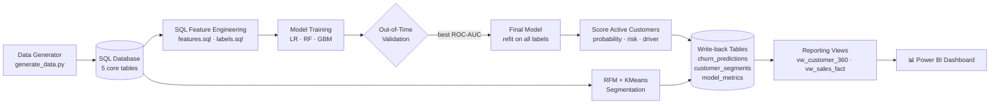
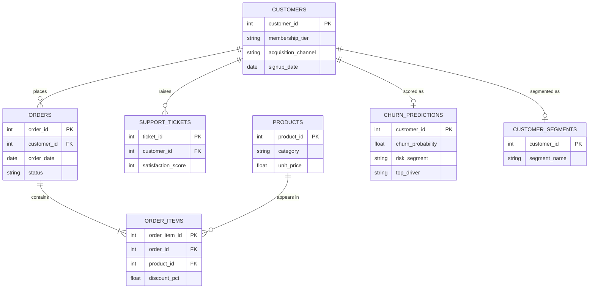

<div align="center">

# 📉 Customer Churn Prediction & Revenue Intelligence

### End-to-end Analytics Pipeline · SQL ➜ Machine Learning ➜ Power BI


*Predict **who** will churn, explain **why**, quantify **how much revenue is at risk**, and turn it into a prioritised retention action list.*

</div>

---

## 📑 Table of Contents
1. [Overview](#-overview)
2. [Business Problem](#-business-problem)
3. [Key Results](#-key-results)
4. [System Architecture](#-system-architecture)
5. [Tech Stack](#-tech-stack)
6. [Dataset & Data Model](#-dataset--data-model)
7. [Pipeline: Step by Step](#-pipeline-step-by-step)
8. [Feature Engineering](#-feature-engineering)
9. [Modelling & Validation Strategy](#-modelling--validation-strategy)
10. [Explainability](#-explainability)
11. [Customer Segmentation (RFM + KMeans)](#-customer-segmentation-rfm--kmeans)
12. [SQL Analytics Highlights](#-sql-analytics-highlights)
13. [Power BI Dashboard](#-power-bi-dashboard)
14. [Business Insights & Recommendations](#-business-insights--recommendations)
15. [Repository Structure](#-repository-structure)
16. [Getting Started](#-getting-started)
17. [Design Decisions](#-design-decisions)
18. [Limitations & Future Work](#-limitations--future-work)
19. [Author](#-author)

---

## 🔍 Overview

This project simulates a production-style **customer analytics system** for an Indian e-commerce company. It combines three layers:

| Layer | Role | Tools |
|---|---|---|
| **Data layer** | Relational storage, point-in-time feature engineering, reporting views | SQL (SQLite / MySQL) |
| **Intelligence layer** | Churn classification, model comparison, explainability, unsupervised segmentation | Python, pandas, scikit-learn |
| **Presentation layer** | Interactive 5-page dashboard with DAX measures and a star schema | Power BI |

Model outputs are **written back into the database**, the same way production ML systems feed BI tools, so the dashboard always reads one consistent source.

---

## 💼 Business Problem

Acquiring a new customer typically costs **5–7× more** than retaining an existing one. In non-subscription e-commerce, churn is *silent*: customers don't cancel, they simply stop ordering.

The business needs to answer:

| Question | Delivered by |
|---|---|
| ❓ *Which customers are likely to stop buying in the next 90 days?* | Churn probability per customer |
| ❓ *Why is each customer at risk?* | Global feature importance + per-customer top driver |
| ❓ *Where should the retention budget go first?* | Revenue-at-risk ranking (₹ impact) |
| ❓ *What does our customer base look like?* | RFM segmentation with KMeans |

**Churn definition:** an active customer (at least one order in the last 180 days) who places **no order in the following 90 days**.

---

## 🏆 Key Results

<div align="center">

| Metric | Value |
|:--|:--:|
| Best model | **Logistic Regression** |
| ROC-AUC (out-of-time test) | **0.834** |
| PR-AUC | **0.756** |
| Recall (churners caught) | **75.3%** |
| Active customers scored | **2,935** |
| High-risk customers flagged | **997** |
| Total revenue at risk | **≈ ₹8.8 Cr** |

</div>

### Model comparison (out-of-time test set, cutoff Oct 2025)

| Model | ROC-AUC | PR-AUC | F1 | Precision | Recall |
|---|:-:|:-:|:-:|:-:|:-:|
| **Logistic Regression** ⭐ | **0.834** | 0.756 | **0.682** | 0.623 | **0.753** |
| Random Forest | 0.831 | **0.762** | 0.666 | **0.686** | 0.647 |
| Gradient Boosting (HistGBM) | 0.822 | 0.755 | 0.664 | 0.672 | 0.657 |

> The simplest, most interpretable model performed best. That suggests the churn signal is largely **monotonic** (e.g. longer inactivity means higher risk), which linear models capture well.

---

## 🏗 System Architecture



---

## 🧰 Tech Stack

- **Languages:** Python 3.10+, SQL, DAX
- **Database:** SQLite (default, zero setup) · MySQL 8 compatible
- **ML:** scikit-learn (`LogisticRegression`, `RandomForestClassifier`, `HistGradientBoostingClassifier`, `KMeans`, `permutation_importance`)
- **Data processing:** pandas, NumPy
- **Model persistence:** joblib
- **BI:** Power BI Desktop (Power Query, star schema modelling, DAX time intelligence)

---

## 🗄 Dataset & Data Model

A **synthetic but behaviourally realistic** dataset is generated to mimic an Indian e-commerce platform (12 cities, 7 product categories, UPI/Card/COD/Wallet payments).

| Table | Rows | Description |
|---|--:|---|
| `customers` | 5,000 | Demographics, city/state, signup date, membership tier, acquisition channel |
| `products` | 210 | 7 categories, log-uniform price distribution |
| `orders` | 47,689 | Order date, status (Delivered / Returned / Cancelled), payment method |
| `order_items` | 95,094 | Product, quantity, unit price, discount % |
| `support_tickets` | 8,373 | Category, resolution hours, CSAT (1–5) |

**How realism is achieved:** each customer has hidden behavioural traits (service-quality experience, discount-seeking, a tier- and channel-dependent churn hazard). Orders follow a **Poisson process** until a latent churn date drawn from an **exponential distribution**. Customers with poor service quality raise more tickets and give lower satisfaction ratings. So the patterns in the data are *causal*, not random, and the model has to discover them.

### Entity-relationship diagram



---

## 🔄 Pipeline: Step by Step

| # | Stage | What happens | File |
|:-:|---|---|---|
| 1 | **Data generation** | Simulate 2 years (Jan 2024 – Dec 2025) of customer behaviour with latent churn dynamics | `data/generate_data.py` |
| 2 | **Database load** | Create schema (PKs, FKs, indexes) and load all tables | `sql/schema.sql` |
| 3 | **Feature engineering** | SQL builds one row per customer from data **≤ cutoff date** only | `sql/features.sql` |
| 4 | **Labelling** | `churned = 1` if no order in the 90 days **after** the cutoff | `sql/labels.sql` |
| 5 | **Active filter** | Keep customers with an order in the last 180 days | `ml/train_and_score.py` |
| 6 | **Model training** | Train LR, RF and GBM on the **Jul-2025** snapshot | `ml/train_and_score.py` |
| 7 | **Out-of-time evaluation** | Evaluate on the **Oct-2025** snapshot; select by ROC-AUC | `ml/train_and_score.py` |
| 8 | **Explainability** | Permutation importance + per-customer top risk driver | `ml/train_and_score.py` |
| 9 | **Final scoring** | Refit on all labelled data, score customers as of **31-Dec-2025** | `ml/train_and_score.py` |
| 10 | **Segmentation** | RFM features → log transform → standardise → KMeans (k = 4) | `ml/train_and_score.py` |
| 11 | **Write-back** | Predictions, segments, metrics and importances saved to SQL | `ml/train_and_score.py` |
| 12 | **Reporting views** | Star-schema friendly views for BI | `sql/powerbi_views.sql` |
| 13 | **Dashboard** | Power BI model, DAX measures, 5 report pages | `powerbi/POWERBI_GUIDE.md` |

### Temporal design (no leakage)

```
 2024-01 ─────────────────────────── 2025-07-04 ──── 2025-10-02 ──── 2025-12-31
          features for TRAIN set  ──►│ train label  │
          features for TEST set   ─────────────────►│  test label   │
          features for SCORING    ──────────────────────────────────►│ ➜ predict next 90 days
```

---

## 🧪 Feature Engineering

All features are computed **in SQL** with CTEs and conditional aggregation, parameterised by `:cutoff`, so the same query produces training, test and live-scoring datasets.

| Group | Feature | Description |
|---|---|---|
| **Recency / Activity** | `recency_days` | Days since last order |
| | `tenure_days` | Days since signup |
| | `orders_last_90d`, `orders_prev_90d` | Orders in the last 90 days and in the 90 days before that |
| | `order_trend` | Change in order count (momentum signal) |
| **Monetary** | `total_spend` | Net delivered revenue |
| | `avg_order_value` | Mean net order value |
| | `spend_last_90d` | Recent spend |
| **Behaviour** | `frequency` | Lifetime order count |
| | `avg_discount_pct` | Discount dependency |
| | `return_rate`, `cancel_rate` | Post-purchase dissatisfaction |
| | `cod_share` | Share of Cash-on-Delivery orders |
| | `max_categories_per_order` | Basket breadth |
| **Service experience** | `tickets_count`, `tickets_last_90d` | Support load |
| | `avg_satisfaction` | Mean CSAT (1–5) |
| | `avg_resolution_hours` | Support responsiveness |
| **Profile** | `age`, `gender`, `membership_tier`, `acquisition_channel` | Categorical/demographic context |

**Preprocessing:** `StandardScaler` for numeric features (linear model), `OneHotEncoder` for categorical features, all wrapped in a scikit-learn `Pipeline` + `ColumnTransformer` so the preprocessing is fitted only on training data.

---

## 🤖 Modelling & Validation Strategy

### Why out-of-time validation?
A random train/test split lets the model see customers from the *future* period during training. That inflates scores and fails in production. Here the model is **trained on one snapshot and tested on a later one**, which mirrors real deployment.

| Split | Cutoff | Customers | Churn rate |
|---|---|--:|--:|
| Train | 2025-07-04 | 3,324 | 30.8% |
| Test | 2025-10-02 | 3,395 | 32.3% |

### Handling class imbalance
- `class_weight="balanced"` on all models
- **PR-AUC** reported alongside ROC-AUC, because it is more informative for the minority (churn) class

### Model selection
The best model is chosen by ROC-AUC (ranking quality matters most for a call list). It is then **refit on train + test** before scoring live customers and saved to `outputs/churn_model.joblib`.

### Risk tiers & business metric

| Risk segment | Rule | Customers |
|---|---|--:|
| 🔴 High | P(churn) ≥ 0.60 | 997 |
| 🟠 Medium | 0.35 ≤ P < 0.60 | 669 |
| 🟢 Low | P < 0.35 | 1,269 |
| ⚫ Inactive (Lost) | No order in 180 days | 2,065 |

```
Revenue at Risk = P(churn) × Annualised Spend
Annualised Spend = Total Spend / max(Tenure, 30 days) × 365
```

---

## 🧠 Explainability

### Global: permutation importance (drop in test ROC-AUC when a feature is shuffled)

| Rank | Feature | Importance |
|:-:|---|:-:|
| 1 | `recency_days` | 0.213 |
| 2 | `tickets_count` | 0.020 |
| 3 | `membership_tier` | 0.017 |
| 4 | `acquisition_channel` | 0.005 |
| 5 | `orders_last_90d` | 0.005 |
| 6 | `orders_prev_90d` | 0.003 |

### Local: per-customer top driver
For each scored customer, the top numeric drivers are converted to **direction-aware z-scores** (the sign comes from each feature's Spearman correlation with churn). The feature with the highest risk-direction deviation becomes a readable reason, e.g. *"Long gap since last order"*, *"Low support satisfaction"* or *"Discount-driven buyer"*. This turns a probability into an **actionable reason** for the retention team.

---

## 🧩 Customer Segmentation (RFM + KMeans)

1. Compute **Recency, Frequency, Monetary** per customer from delivered orders
2. Apply `log1p` to reduce skew, then standardise
3. Run **KMeans (k = 4, n_init = 20)**
4. Rank cluster centroids by `F + M − R` and name them automatically

| Segment | Customers | Profile |
|---|--:|---|
| 🏆 Champions | 1,152 | Recent, frequent, high spend |
| 💙 Loyal | 894 | Steady repeat buyers |
| ⚠️ At Risk | 1,589 | Previously active, slowing down |
| 💤 Hibernating | 1,218 | Long inactive, low value |

---

## 🧮 SQL Analytics Highlights

`sql/analysis_queries.sql` contains 8 business queries showing advanced SQL:

| # | Query | Techniques |
|:-:|---|---|
| 1 | Monthly revenue with MoM growth | CTE, `LAG()` window function |
| 2 | Top 3 products per category | `DENSE_RANK() OVER (PARTITION BY …)` |
| 3 | Signup-cohort retention (M3 / M6 / M12) | Cohort analysis, conditional `COUNT DISTINCT` |
| 4 | Churn risk by tier × channel | Joins with ML output, aggregation |
| 5 | Support satisfaction vs churn risk | CTE, `CASE` banding |
| 6 | Retention call list | Filtering and ranking by ₹ impact |
| 7 | Running revenue total | `SUM() OVER (ROWS UNBOUNDED PRECEDING)` |
| 8 | Customers with > 50% frequency drop | Time-window comparison |

<details>
<summary><b>Example: month-over-month revenue growth</b></summary>

```sql
WITH m AS (
    SELECT strftime('%Y-%m', order_date) AS month,
           SUM(net_amount)               AS revenue
    FROM   vw_sales_fact
    WHERE  status = 'Delivered'
    GROUP BY 1
)
SELECT month,
       ROUND(revenue, 0) AS revenue,
       ROUND(100.0 * (revenue - LAG(revenue) OVER (ORDER BY month))
             / LAG(revenue) OVER (ORDER BY month), 1) AS mom_growth_pct
FROM m
ORDER BY month;
```
</details>

---

## 📊 Power BI Dashboard

**Data model:** star schema with `vw_sales_fact` and `vw_support_fact` as facts, and `vw_customer_360`, `products` and a DAX-generated `DimDate` as dimensions.

| Page | Purpose | Key visuals |
|---|---|---|
| 1. Executive Overview | Business health | Revenue, YoY %, AOV, return rate, revenue trend vs last year, sales by category/state |
| 2. Churn Risk | ML insights | High-risk count, revenue at risk, tier × channel risk heatmap, top drivers, **retention call list** |
| 3. Customer Segments | RFM view | Frequency vs monetary scatter by segment, segment × risk breakdown |
| 4. Support & Experience | Service quality | CSAT, resolution time, ticket categories, CSAT vs churn |
| 5. Model Performance | Transparency | Model comparison, feature importance, validation notes |

<details>
<summary><b>Sample DAX measures</b></summary>

```DAX
Total Revenue =
CALCULATE ( SUM ( vw_sales_fact[net_amount] ), vw_sales_fact[status] = "Delivered" )

Revenue YoY % =
VAR LY = CALCULATE ( [Total Revenue], SAMEPERIODLASTYEAR ( DimDate[Date] ) )
RETURN DIVIDE ( [Total Revenue] - LY, LY )

High Risk Revenue =
CALCULATE ( SUM ( vw_customer_360[revenue_at_risk] ), vw_customer_360[risk_segment] = "High" )

Potential Savings (30% save) = [High Risk Revenue] * 0.30
```
</details>

The full build guide, with 20+ measures and visual specifications, is in [`powerbi/POWERBI_GUIDE.md`](powerbi/POWERBI_GUIDE.md).

<!-- Add screenshots after building the dashboard:


-->

---

## 💡 Business Insights & Recommendations

| Insight | Evidence | Recommendation |
|---|---|---|
| **Inactivity is the strongest warning sign** | `recency_days` dominates importance (0.21) | Trigger automated win-back campaigns when a customer passes their usual purchase gap |
| **Paid-ad customers are the least loyal** | Basic + Paid Ads: **66.7%** avg risk, the highest of all segments | Re-evaluate ad targeting; track customer lifetime value against acquisition cost by channel |
| **Membership drives retention** | Gold churn risk is far lower than Basic | Offer Silver/Gold upgrades to high-value Basic customers |
| **Support quality affects churn** | CSAT < 2.5: **58.5%** risk vs **37.6%** with no tickets | Reduce resolution time and follow up on low-CSAT tickets |
| **Prioritise by ₹, not by count** | Revenue at risk ≈ ₹8.8 Cr | Work the call list sorted by revenue at risk |

---

## 📁 Repository Structure

```
customer-churn-revenue-intelligence/
│
├── data/
│   └── generate_data.py          # Synthetic data generator → SQLite
│
├── sql/
│   ├── schema.sql                # Tables, keys, indexes (core + ML output)
│   ├── features.sql              # Point-in-time feature engineering
│   ├── labels.sql                # 90-day churn label
│   ├── analysis_queries.sql      # 8 advanced business queries
│   └── powerbi_views.sql         # Reporting views for BI
│
├── ml/
│   └── train_and_score.py        # Train · validate · explain · score · segment · write back
│
├── powerbi/
│   ├── POWERBI_GUIDE.md          # Data model, DAX, page-by-page dashboard spec
│   └── data/                     # CSV exports for Power BI
│
├── outputs/                      # Generated: ecommerce.db, churn_model.joblib
├── requirements.txt
├── LICENSE
└── README.md
```

---

## 🚀 Getting Started

### Prerequisites
- Python 3.10+
- Power BI Desktop (Windows), for the dashboard
- *(Optional)* MySQL 8+

### Installation
```bash
git clone https://github.com/<your-username>/customer-churn-revenue-intelligence.git
cd customer-churn-revenue-intelligence
pip install -r requirements.txt
```

### Run the pipeline
```bash
# 1. Generate data and build the SQLite database (~30 s)
python data/generate_data.py

# 2. Train, evaluate, score, segment, write back and export CSVs (~10 s)
python ml/train_and_score.py
```

**Expected console output (abridged):**
```
Train (cutoff 2025-07-04): 3,324 customers, churn rate 30.8%
Test  (cutoff 2025-10-02): 3,395 customers, churn rate 32.3%
Logistic Regression  ROC_AUC=0.834  PR_AUC=0.756  F1=0.682 ...
Best model: Logistic Regression (ROC-AUC 0.834)
Scored 2,935 active customers | High risk: 997
```

### Build the dashboard
Open Power BI Desktop → **Get Data → Text/CSV** → load the files in `powerbi/data/` → follow [`POWERBI_GUIDE.md`](powerbi/POWERBI_GUIDE.md).

### Run on MySQL (optional)
Run `sql/schema.sql` in MySQL, load the tables, and apply these dialect changes:

| SQLite | MySQL |
|---|---|
| `julianday(a) - julianday(b)` | `DATEDIFF(a, b)` |
| `date(x, '-90 day')` | `DATE_SUB(x, INTERVAL 90 DAY)` |
| `strftime('%Y-%m', d)` | `DATE_FORMAT(d, '%Y-%m')` |

All randomness is seeded (`SEED = 42`), so results are **fully reproducible**.

---

## 🧭 Design Decisions

| Decision | Rationale |
|---|---|
| Feature engineering in **SQL**, not pandas | Pushes computation to the database, works at scale, and the same logic can be reused by analysts |
| **Parameterised cutoff** query | One query serves training, testing and live scoring, with a guaranteed point-in-time definition |
| **Active-customer filter** (180 days) | Long-gone customers are trivially "churned" and would inflate metrics without adding value |
| **Out-of-time** validation | Mirrors deployment; avoids optimistic random-split estimates |
| Choosing **Logistic Regression** | Best ROC-AUC *and* most interpretable, which matters for stakeholder trust |
| **Write-back** to SQL | One source of truth for BI; mirrors production ML architecture |
| **Revenue at risk** metric | Translates model output into business value (₹) for prioritisation |

---

## 🔮 Limitations & Future Work

**Limitations**
- The data is synthetic. Real data would have noise, seasonality and missing values.
- A fixed 0.5 classification threshold is used rather than a cost-optimised one.
- Probabilities are not calibrated.

**Roadmap**
- [ ] **SHAP** values for richer local explanations
- [ ] **Cost-sensitive threshold** tuning (retention offer cost vs customer value)
- [ ] Probability **calibration** (Platt / isotonic)
- [ ] **Survival analysis** (Cox / Kaplan-Meier) to predict *when* a customer will churn
- [ ] **CLV prediction** (BG/NBD + Gamma-Gamma)
- [ ] Hyperparameter tuning with time-series cross-validation
- [ ] Orchestration with **Airflow**, plus a **FastAPI** scoring endpoint
- [ ] Model monitoring (data drift, performance decay)
- [ ] Power BI Service deployment with scheduled refresh

---

## 👤 Author

**Piyush Yadav**
M.Tech, Artificial Intelligence & Data Science, IIT (ISM) Dhanbad

[](https://github.com/<your-username>)
[](https://linkedin.com/in/<your-profile>)

---

<div align="center">

⭐ If you found this project useful, consider giving it a star!

</div>
